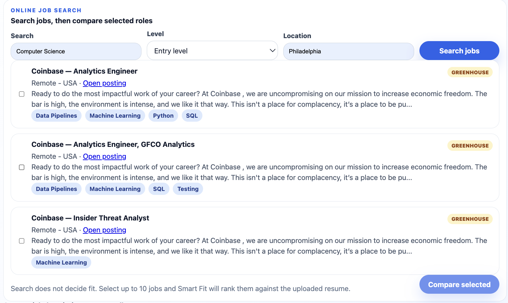
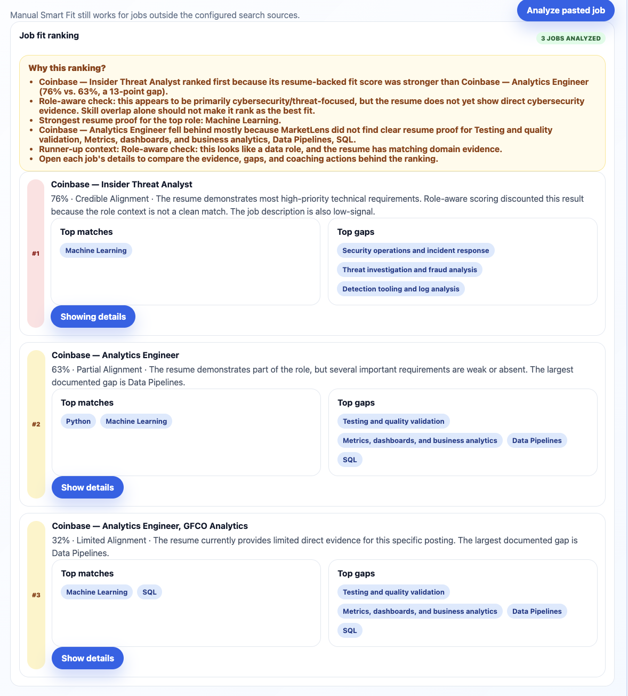
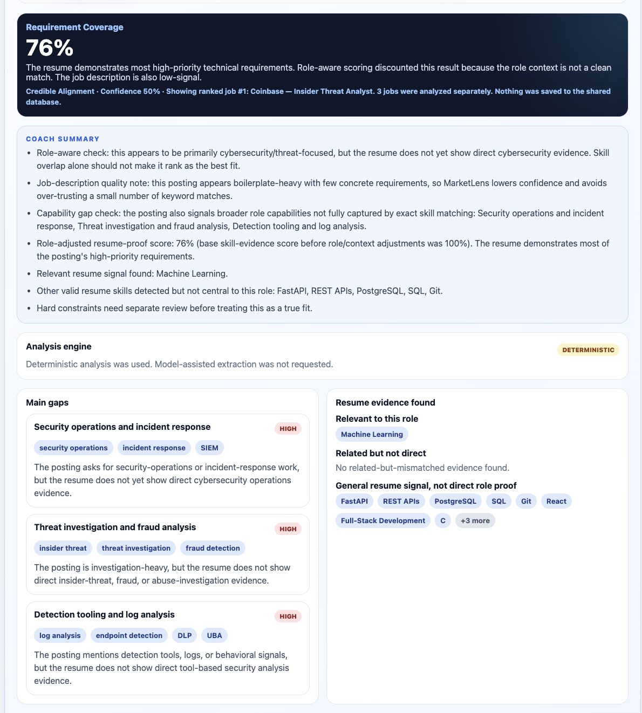
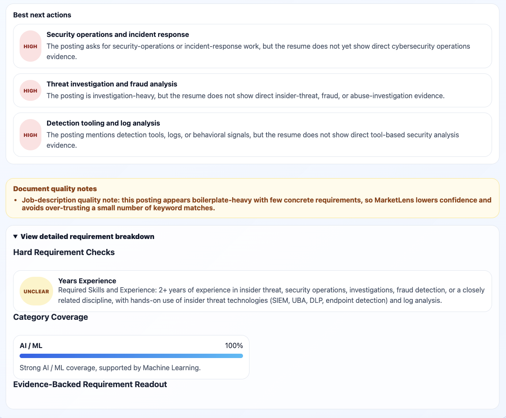
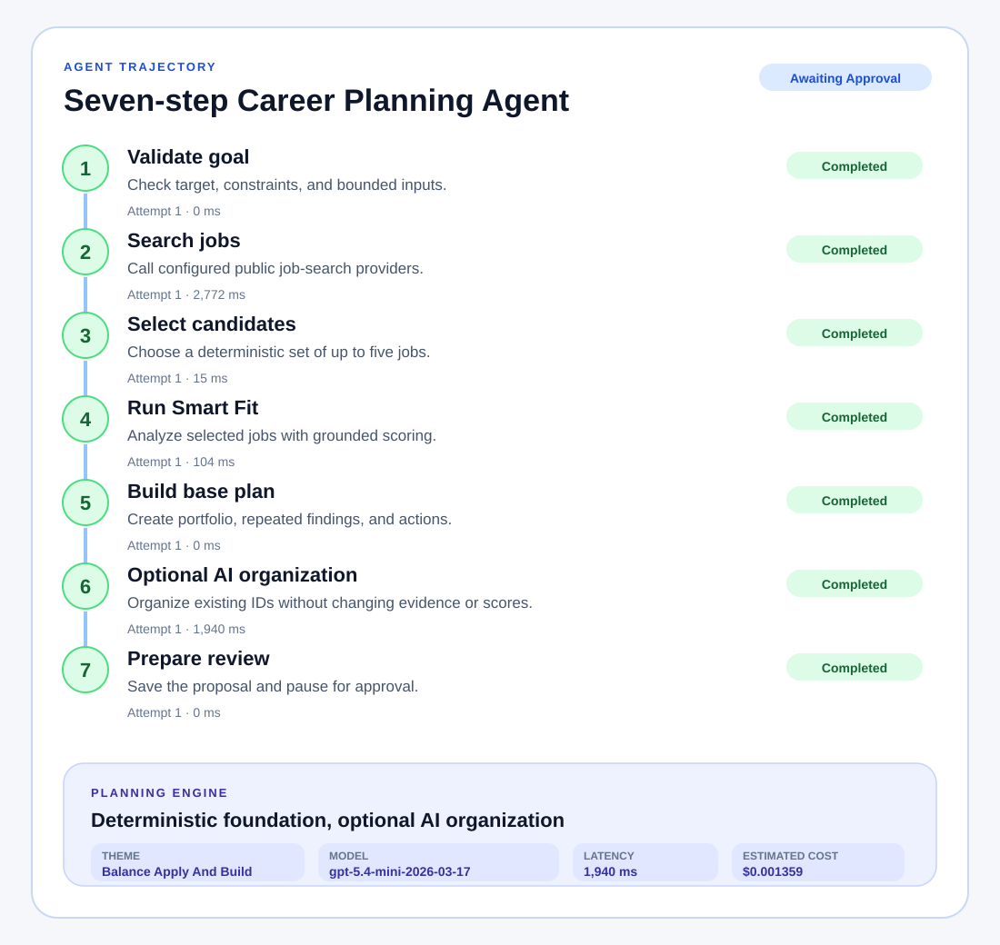
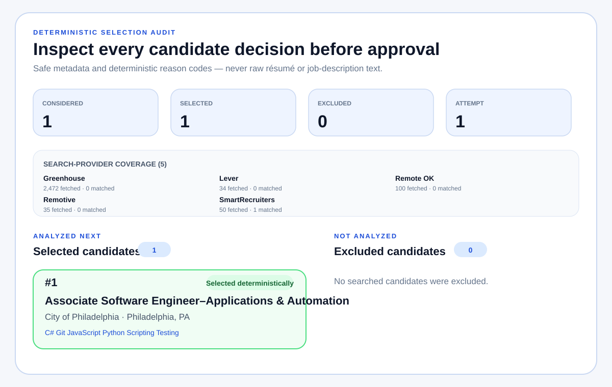
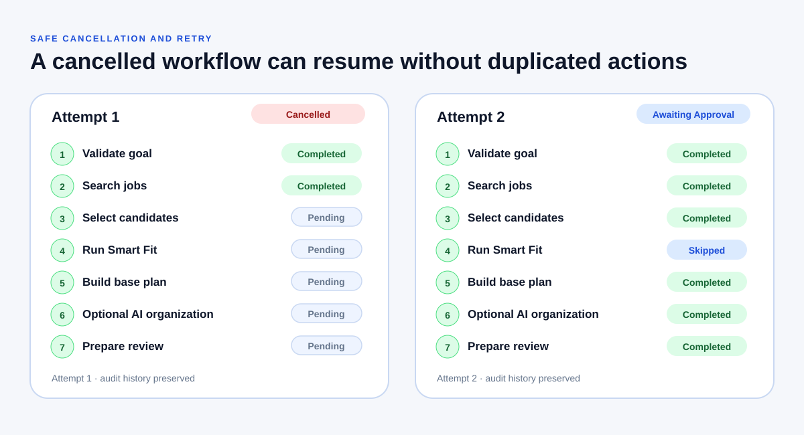
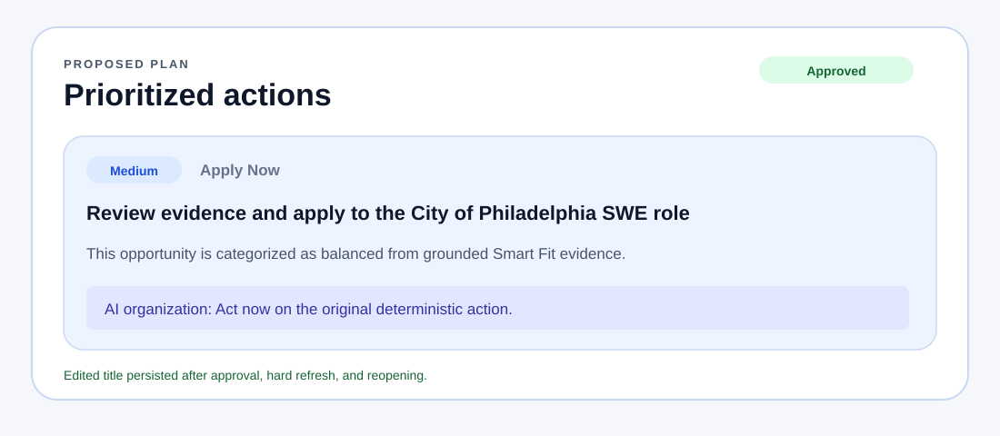

# MarketLens Career Intelligence

[Try MarketLens](https://marketlens-career-intelligence-production-8a34.up.railway.app) | [Demo guide](docs/portfolio-demo-walkthrough.md)

MarketLens is a web app I built to make job searches easier to evaluate. It searches supported public job sources, compares job requirements with a resume, and shows the evidence behind each match. People can review a job's requirements, see where their experience fits, and identify gaps worth working on.

The app has two main parts:

- **Job Intelligence:** Search for openings, compare jobs against a resume, and see the reasons behind each Smart Fit ranking.
- **Career Plans:** Choose a target role and create a private plan with suggested next steps. The app tracks each step of the process, and users can edit or approve the final plan. AI can help organize the results, but it cannot change job scores or evidence.

## See it in action

- [Screenshots](#product-screenshots)
- [Live demo](https://marketlens-career-intelligence-production-8a34.up.railway.app)
- [How to run it locally](#running-locally)
- [Testing results](#evaluation-and-production-validation)
- [Security and privacy](#security-and-privacy)

## Technical work

- Built the frontend with React and TypeScript and the API with FastAPI, using PostgreSQL in production.
- Added occupation search coverage across all 23 SOC major groups. Ambiguous titles and abbreviations require clarification instead of returning unrelated jobs.
- Tested search behavior with 268 held-out occupation queries and 92 title checks. The linked evaluation reports explain what those numbers cover.
- Used rules-based analysis for scores, job selection, and evidence. The optional AI step only organizes information already produced by the app.
- Added authentication, ownership checks, PostgreSQL row-level security, and security tests for the production deployment.

## Tech stack

| Area | Tools |
| --- | --- |
| Frontend | React, TypeScript, Vite, CSS |
| Backend | Python, FastAPI, Pydantic, SQLAlchemy |
| Database | SQLite locally; PostgreSQL through a restricted runtime role in production |
| Authentication | Clerk frontend sessions with backend bearer-token verification |
| Job sources | Greenhouse, Lever, named SmartRecruiters employer boards, Remote OK, Remotive |
| AI integration | Backend-only Responses API configuration, strict schemas, deterministic fallback |
| Testing | pytest, deterministic evaluators, adversarial fixtures, GitHub Actions, Docker builds |
| Deployment | Railway frontend and backend services |

## Demo and technical reports

- **Frontend:** [MarketLens live demo](https://marketlens-career-intelligence-production-8a34.up.railway.app)
- **Backend health:** [API health endpoint](https://marketlens-career-intelligence-production.up.railway.app/health)
- **Deployment identity:** [Safe backend revision endpoint](https://marketlens-career-intelligence-production.up.railway.app/deployment/status)
- **Portfolio walkthrough:** [How to demo MarketLens](docs/portfolio-demo-walkthrough.md)
- **Career Plan evaluation:** [Milestone 8.1 agent evaluation](docs/milestone-8-1-agent-evaluation.md)
- **Career Plan sign-off:** [Milestone 8.1 completion record](docs/milestone-8-1-completion.md)
- **Universal-search evaluation:** [Milestone 8.1I held-out occupation evaluation](docs/milestone-8-1i-held-out-occupation-evaluation.md)
- **Milestone 8 search sign-off:** [Universal search production sign-off](docs/milestone-8-universal-search-signoff.md)
- **Security audit:** [Milestone 8.2 security audit baseline](docs/milestone-8-2-security-audit.md)
- **RLS production cutover:** [Milestone 8.2C PostgreSQL RLS cutover](docs/milestone-8-2c-postgres-rls-cutover.md)
- **Final security sign-off:** [Milestone 8.2F security sign-off](docs/milestone-8-2f-security-signoff.md)

Production FastAPI `/docs`, `/redoc`, and `/openapi.json` are intentionally disabled for security reasons.

MarketLens is a personal project. Please do not upload secrets, confidential company data, or sensitive personal information.

## Product screenshots

### Job Intelligence screenshots

MarketLens searches configured public sources and reports which providers were attempted.



Users can compare multiple jobs against one resume and inspect why one opportunity ranked above another.



Reports distinguish direct resume proof from broader signals and surface role-specific capability gaps.



Deterministic recommendations keep hard requirements separate from broader career-development guidance.



### Career Plans screenshots

The authenticated production workspace displays every persisted step and separates deterministic planning from optional bounded AI organization.



Users can inspect provider coverage, considered jobs, selected jobs, excluded jobs, and deterministic reason codes before approval.



A production run was cancelled after search and successfully completed as attempt two without duplicated actions or lost audit history.



User edits remain separate from the immutable generated proposal and persist after approval, refresh, and reopening.



The privacy-safe Career Plans visuals reproduce captured production states while excluding raw resume text and account details. Responsive behavior was separately validated at a 400 × 770 viewport.

## Current product workflow

### Job Intelligence

```text
Open MarketLens
Optionally sign in for private saving
Upload or paste a resume
Search configured public job sources
Choose occupation, experience level, and optional location
Inspect interpretation, provider coverage, warnings, and bounded results
Select one or more jobs
Run role-aware Smart Fit
Review ranking, evidence, requirements, gaps, and coaching
Explicitly save jobs or reduced reports when signed in
```

Manual comparison remains available for postings outside configured public sources:

```text
Upload or paste a resume
Paste one or more job descriptions
Separate multiple postings with ---
Run Smart Fit and compare results
Explicitly save a reduced report when signed in
```

### Career Planning Agent

```text
Sign in
Open Career Plans
Define a target occupation and practical constraints
Provide a resume for request-time analysis
Create and execute a bounded planning run
Watch seven persisted workflow steps
Inspect source coverage and candidate selection/exclusion reasons
Review opportunity categories, recurring strengths, recurring gaps, and actions
Inspect deterministic reasoning and optional AI contribution
Ask bounded “Why?” questions
Edit, approve, reject, save, reopen, retry, cancel, or delete the plan
```

The seven workflow steps are:

1. validate input
2. search jobs
3. select candidates
4. analyze Smart Fit
5. synthesize a deterministic plan
6. optionally organize the plan with one bounded model call
7. finalize the proposal for human review

## How job search handles titles and locations

MarketLens evaluates occupation, experience level, industry, and location as separate concerns.

The occupation layer recognizes canonical titles, accepted alternate titles, spelling and punctuation variants, reordered phrases, and safe abbreviations across every SOC major group. Bare ambiguous acronyms such as `SAE`, `PM`, `PA`, and `SE` are not silently expanded; MarketLens asks the user to choose a meaning before any provider search.

Specific occupations require title-level evidence. A shared word such as `engineer`, `analyst`, `assistant`, `technician`, `editor`, or `manager` is not sufficient by itself. Production guards protect distinctions including:

- accountant vs. accountant partner programs or generic rotations
- financial analyst vs. generic finance fellowships
- registered nurse vs. LPN/LVN and advanced-practice titles
- medical assistant vs. medical fellowships
- electrician vs. electrical engineer
- policy analyst vs. data analyst
- journalism editor vs. video editor

Unrecognized searches stop before contacting job providers. Recognized occupations with no current configured-source result receive an explicit explanation and canonical continuation links rather than unrelated jobs.

Supported experience levels are `any`, `intern`, `entry`, `mid`, and `senior`. Explicit city searches use bounded metro aliases rather than unrestricted location matching.

MarketLens uses public APIs rather than scraping closed platforms:

- Greenhouse Job Board API
- Lever Postings API
- selected SmartRecruiters employer boards
- Remote OK public feed
- Remotive public API

It does not claim to search all of LinkedIn, Indeed, Handshake, Workday, school portals, or every company career site.

## Limits on AI assistance

MarketLens is not an unrestricted career chatbot and does not autonomously act on a user’s behalf.

The agent:

- calls the existing search and Smart Fit implementations through typed boundaries
- analyzes at most five jobs per run
- creates at most twenty proposed actions
- uses at most one Career Plan model call
- persists workflow state, attempts, safe summaries, and audit events
- treats job content and resume content as untrusted data
- returns a complete deterministic plan when AI is disabled or fails
- requires an explicit user decision before a plan becomes approved or rejected

The model cannot:

- change Smart Fit scores or confidence
- change evidence statuses or provenance
- override hard-requirement findings
- add jobs or deterministic actions
- invent experience, credentials, projects, or resume claims
- apply to jobs, message recruiters, edit profiles, or purchase services
- bypass authentication or human approval
- predict interviews, offers, salary, or hiring probability

## Current capabilities

All visitors can:

- upload `.txt`, `.md`, `.pdf`, or `.docx` resumes for request-time extraction
- paste resume text manually
- search configured public sources across a SOC-aligned cross-sector occupation registry
- receive clarification instead of guessed results for ambiguous occupation acronyms
- receive an explanation for unsupported unknown queries
- inspect provider-by-provider coverage, warnings, suggestions, and continuation links
- compare one to ten searched or manually pasted jobs through Smart Fit
- review requirements, evidence, rankings, gaps, limitations, and coaching actions
- use deterministic analysis when model-assisted stages are unavailable

Signed-in users can additionally:

- save, reopen, and delete jobs privately
- save and delete reduced Smart Fit summaries
- create private Career Plan runs
- inspect all seven workflow steps and safe audit history
- cancel and retry active or failed runs
- review selected and excluded candidates with deterministic reason codes
- inspect opportunity categories, repeated strengths, repeated gaps, and proposed actions
- request bounded explanations from saved plan data
- edit, approve, reject, reopen, and delete owned plans

## Security and privacy

Current controls include:

- Clerk-managed authentication instead of custom password storage
- backend verification of Clerk session tokens and authorized parties
- server-side ownership filters for every private resource, with cross-user object access returning non-enumerating `404` responses where designed
- a PostgreSQL restricted runtime role separated from the migration/table-owner credential
- forced PostgreSQL row-level security on `saved_jobs`, `saved_reports`, `career_plan_runs`, `career_plan_steps`, and `career_plan_audit_events`
- transaction-local authenticated-user database context through `app.current_user_id`
- runtime-role restrictions including no superuser, role/database creation, inheritance, RLS bypass, protected-table ownership, public-schema creation, or migration-metadata access
- no automatic persistence of analysis inputs
- raw resume text and full job descriptions excluded from Career Plan and saved-report records
- backend-only model-provider keys
- request-scoped credential/document redaction and safe HTTP error behavior
- strict model response schemas and reference validation
- public request, file, CSV, search, provider, and workflow bounds, including a 2 MB request-body ceiling
- DOCX archive/decompression/XML limits and PDF page/decompression/content limits
- safe HTTPS application-link validation
- production CSP, HSTS, frame, MIME-sniffing, referrer, permissions, and no-store controls
- production API documentation disabled
- backend and frontend production containers running as non-root users
- Python/npm dependency audits, Bandit, CodeQL, full-history secret scanning, and safe-log regression tests
- Trivy scans of the actual production images, machine-enforced critical/high policy, and CycloneDX SBOM evidence
- explicit deterministic fallback for provider or model failure

See [`SECURITY.md`](SECURITY.md) for the current security policy and limitations.

## Milestone 8.2 production security sign-off

Milestone 8.2A through 8.2F is complete.

- **8.2A: Threat model and audit baseline:** complete
- **8.2B: Production authentication and authorization hardening:** complete
- **8.2C: PostgreSQL RLS and least privilege:** complete, including the owner-controlled production restricted-runtime/RLS cutover
- **8.2D: API, upload, browser, and container hardening:** complete and production verified
- **8.2E: Security CI and supply-chain gates:** complete
- **8.2F: Final production security sign-off:** complete

The functional production security candidate used for the final evidence is:

```text
39570fb853be4f9cd670ea6d4670d334abcdd758
```

Final evidence includes:

- backend health and deployment identity returning the exact functional candidate revision
- frontend exact-revision production verification
- successful Production Security Surface checks for private-route authentication boundaries, disabled API documentation, CORS, security headers, CSP, and no-store behavior
- successful PostgreSQL security migration and restricted-runtime verification
- forced RLS enabled on all five protected tables
- Railway backend switched from the migration/table-owner credential to the restricted runtime database role
- direct restricted-runtime default-deny behavior with no request identity
- an authenticated synthetic production Career Plan flow successfully creating a run (`201`), executing it (`200`), reaching `awaiting_approval` with all seven workflow steps, and deleting the test run (`200`)
- live two-independent-user isolation across saved jobs, saved reports, and Career Plans, with cross-user access returning `404` where designed while same-user operations continued to work normally
- owner review confirming the ongoing backend runtime variable set does not contain the migration/owner database connection
- owner review of production logs around the verification window showing request metadata only and no observed bearer/JWT tokens, database credentials, stack traces, or submitted test bodies
- a pre-cutover production PostgreSQL backup created on owner-controlled local Mac storage because Railway-managed backup/PITR is unavailable on the current plan
- final residual risks recorded explicitly rather than hidden

Final decision:

```text
GO: MILESTONE 8.2 SECURITY HARDENING COMPLETE
```

GitHub issue #122 and umbrella issue #120 are closed as completed.

## Evaluation and production validation

### Career Planning Agent

The original Milestone 8.1 Career Planning Agent sign-off included:

- ten representative career sectors
- ten committed task-level cases
- three repeated deterministic executions per case
- thirty stable agent executions with zero failed cases
- prompt-injection inputs across descriptions, titles, company metadata, URLs, and authenticated resume text
- model timeout, transport, HTTP, invalid JSON, schema, reference, duplicate, and policy-changing output cases
- cancellation and failed-run retry recovery without duplicated actions
- automated and production ownership-isolation checks
- provider telemetry, cost, token, payload, and latency policies
- 447 backend tests at the original agent sign-off
- frontend production build and both Docker images
- exact-revision Railway canaries and authenticated browser validation

See [`docs/milestone-8-1-completion.md`](docs/milestone-8-1-completion.md) for the full agent evidence.

### Universal occupation search

The final Milestone 8 universal-search validation passed:

| Measurement | Result |
| --- | ---: |
| Held-out occupation queries | 268 / 268 |
| Held-out title checks | 92 / 92 |
| SOC major groups | 23 / 23 |
| Held-out career spheres | 30 |
| Explicit ambiguous acronyms | 33 |
| Exact-revision production audit | 40 / 40 cases |
| Production career spheres | 14 |
| Manually reviewed production titles | 47 / 47 relevant |
| Returned-title precision | 100.0% |
| Backend test suite at universal-search sign-off | 528 / 528 |

The final universal-search production audit ran against functional runtime revision:

```text
9bd59046bc9c1f4efedc2ab13f2708c142a353e5
```

Both Railway services, the Production Career Plan Canary, the Milestone 8E Production Canary, and the Production Occupation Audit passed for that sign-off.

### Security hardening validation

The Milestone 8.2 security workstream recorded 539 normal backend tests, with the 7 PostgreSQL-specific security tests separated from that run, plus a dedicated 7/7 PostgreSQL RLS/verifier gate. It also included frontend and Docker builds, dependency audits, Bandit, CodeQL, full-history secret/log safety, production-image scanning, SBOM generation, and exact-revision production security checks.

See:

- [`docs/milestone-8-1i-held-out-occupation-evaluation.md`](docs/milestone-8-1i-held-out-occupation-evaluation.md)
- [`docs/milestone-8-universal-search-signoff.md`](docs/milestone-8-universal-search-signoff.md)
- [`docs/milestone-8-2f-security-signoff.md`](docs/milestone-8-2f-security-signoff.md)

## Backend API

Important public endpoints include:

- `GET /health`
- `GET /deployment/status`
- `GET /jobs/search`
- `POST /skills/extract`
- `POST /analysis/resume-file/extract`
- `POST /analysis/smart`
- `POST /analysis/smart/batch`
- `GET /analysis/model-status`

Authenticated Career Plan endpoints include:

- `POST /career-plans`
- `GET /career-plans`
- `GET /career-plans/{run_id}`
- `POST /career-plans/{run_id}/execute`
- `POST /career-plans/{run_id}/cancel`
- `POST /career-plans/{run_id}/explain`
- `POST /career-plans/{run_id}/decision`
- `DELETE /career-plans/{run_id}`

Shared posting creation, CSV import, and deletion remain admin-only operations protected by `X-Admin-API-Key`.

## Running locally

### Backend

```bash
cd backend
python -m venv .venv
source .venv/bin/activate
python -m pip install --upgrade pip
python -m pip install -r requirements.txt
python -m uvicorn app.main:app --reload
```

### Frontend

```bash
cd frontend
npm install
npm run dev
```

The frontend reads `VITE_API_BASE_URL` and `VITE_CLERK_PUBLISHABLE_KEY`. Railway runtime configuration also exposes a sanitized deployment revision through `config.js`.

### Quality checks

```bash
cd backend
python -m pytest
python scripts/run_job_search_evaluation.py
python scripts/run_held_out_occupation_evaluation.py
python scripts/run_career_plan_agent_evaluation.py
```

```bash
cd frontend
npm ci
npm run build
```

```bash
docker build -t marketlens-backend ./backend
docker build --build-arg VITE_API_BASE_URL=http://localhost:8000 -t marketlens-frontend ./frontend
```

Exact-revision production occupation audit:

```bash
cd backend
EXPECTED_REVISION=<40-character-sha> \
AUDIT_WAIT_SECONDS=900 \
python scripts/run_production_occupation_audit.py
```

Full automated authenticated Career Plan mode additionally requires short-lived canary bearer tokens stored outside the repository.

## Project status

Job search, Smart Fit comparison, private Career Plans, and the security work described above are implemented. Testing records and production checks are linked in the [demo and evaluation section](#demo-and-technical-reports). Future work is listed below.

## Not implemented

The following are not implemented by the completed product scope:

- autonomous or mass job applications
- recruiter messaging or email automation
- external profile editing
- course or service purchasing
- unrestricted multi-agent delegation
- closed-platform scraping
- full O*NET-generated occupation-registry importer
- full Career Evidence Graph
- GitHub evidence verification
- resume claim verification
- complete application tracker and outcome-learning loop
- long-term labor-market trend forecasting
- guaranteed interview, offer, salary, or career outcomes
